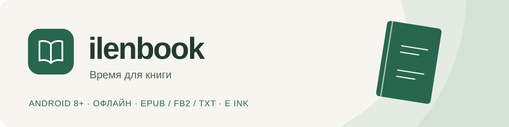
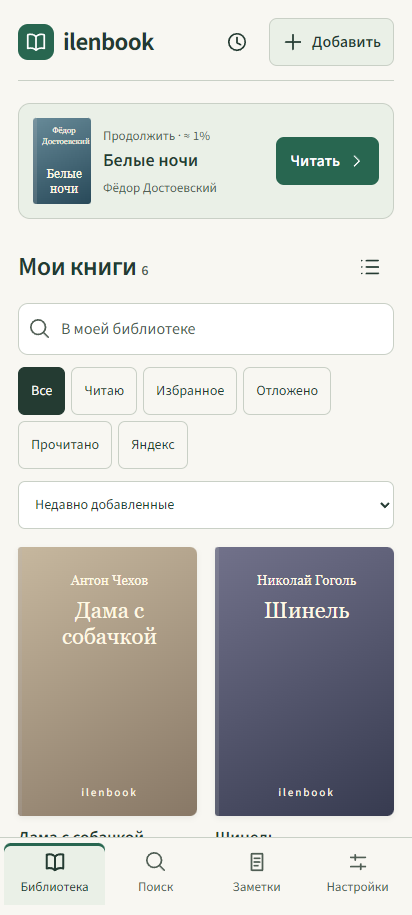
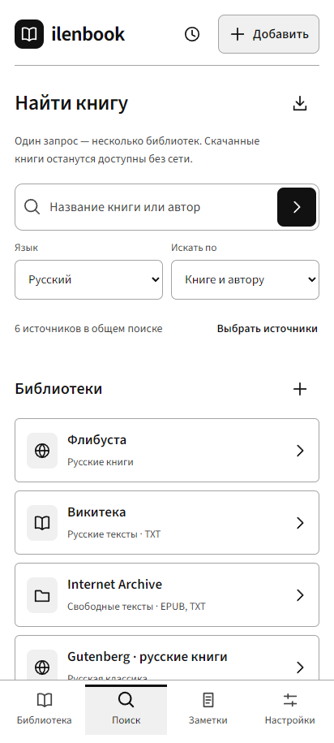

<p align="center">
  
</p>

<p align="center">
  <a href="https://github.com/Lonviser/ilenbook/releases/latest"></a>
  
  
  <a href="https://github.com/Lonviser/ilenbook/actions/workflows/checks.yml"></a>
</p>

<p align="center"><strong>Своя библиотека. Комфортное чтение. Несколько каталогов в одном поиске.</strong></p>

<p align="center">
  <a href="https://github.com/Lonviser/ilenbook/releases/latest"><strong>Скачать APK</strong></a> ·
  <a href="docs/USER_GUIDE.md">Руководство</a> ·
  <a href="docs/RELEASE_NOTES_0.7.1.md">Что нового</a> ·
  <a href="https://github.com/Lonviser/ilenbook/issues/new/choose">Сообщить об ошибке</a>
</p>

ilenbook — Android-читалка для личной библиотеки на телефоне, планшете и сенсорной электронной книге. Импортируйте свои EPUB, FB2 и TXT, ищите новые книги в каталогах, сохраняйте цитаты и читайте без сети. Есть отдельный режим E Ink с контрастным интерфейсом и минимумом эффектов.

## На экране

<p align="center">
  
  &nbsp;&nbsp;
  
</p>

<p align="center"><sub>Скриншоты полки и поиска версии 0.7.0. Крупная полка и поиск в режиме E Ink.</sub></p>

<p align="center">
  
</p>
<p align="center"><sub>Панель чтения в 0.7.1: отдельные проценты книги и главы.</sub></p>

## Возможности

| Для чего | Что есть |
|---|---|
| Своя библиотека | Импорт EPUB / FB2 / FB2.ZIP / TXT, крупная и компактная полка, список, коллекции, серии, избранное и статусы |
| Комфортное чтение | Страницы или прокрутка, отдельные проценты книги и главы, касания краёв, девять настраиваемых зон, жесты и кнопки громкости |
| Свой внешний вид | Literata, Lora, Source Sans 3, системные шрифты и импорт TTF/OTF, поля, интервалы, темы и профили для отдельных книг |
| Работа с текстом | Оглавление, индексируемый поиск, закладки, цитаты, комментарии, теги и экспорт Markdown |
| Поиск книг | Параллельные источники, история, язык/формат/источник, сортировка, повтор отдельного запроса и выдача из кэша |
| Личная статистика | Время по дням и книгам, завершения и перелистывания, периоды 1/7/30 дней и CSV |
| Сохранность | ZIP-копия библиотеки и настроек, оригинальные файлы для других читалок, системный импорт/экспорт и передача по Wi-Fi |
| Словарь | Импорт JSON-словаря, Викисловарь по запросу, перевод через MyMemory и сохранённые слова |

## Каталоги

| Источник | Сценарий |
|---|---|
| Флибуста | OPDS-поиск книг и авторов, обложки, исходные файлы, резервное подключение через Tor/Snowflake |
| Викитека | Русские произведения и тексты; сохранение выбранной страницы в TXT со ссылкой на ревизию |
| Internet Archive | Текстовые издания с объявленной свободной лицензией; доступные EPUB/TXT и обложки |
| Project Gutenberg | Русский и общий OPDS-каталоги классики |
| Wolne Lektury | Польская литература |
| Ebooks libres et gratuits | Французская литература |
| Свой источник | Добавление OPDS-адреса и шаблона поиска |

Выберите участвующие библиотеки через **Поиск → Выбрать источники**. Быстрые ответы показываются сразу, ошибка одного источника не убирает остальные. По умолчанию включён русский язык; книги с неуказанным языком также остаются в выдаче. Для других языков выберите «Все языки».

Скорость и доступность внешних серверов меняются. Флибуста использует HTTPS/HTTP, включая адрес обложек и файлов; HTTP не шифрует прямой трафик. При недоступности прямого соединения доступен встроенный Tor и мост Snowflake. **Поиск → Подключение Флибусты** позволяет выбрать режим и проверить живой каталог. Первый запуск резервного соединения может занять до трёх минут; уже скачанные книги от него не зависят. Internet Archive проверяется по опубликованным метаданным издания. Викитека сохраняет только выбранную страницу, без автоматического объединения её подстраниц и иллюстраций.

## Установка

1. Откройте [последний релиз](https://github.com/Lonviser/ilenbook/releases/latest) и скачайте `ilenbook-0.7.1.apk`.
2. Откройте APK стандартным установщиком Android. При необходимости разрешите установку из выбранного браузера или файлового менеджера.
3. При обновлении устанавливайте поверх прежнего APK **без удаления приложения** — пакет и подпись сохраняются.
4. В **Настройки → Сохранить резервную копию** создайте ZIP и храните его отдельно от приложения.

Android **8.0+**. Интернет нужен для каталогов, загрузок и онлайн-сервисов; уже сохранённые книги, заметки и позиции доступны офлайн. Контрольные SHA-256 опубликованы рядом с APK.

## Яндекс Книги

В настройках есть экспериментальное подключение аккаунта: получение библиотеки, процентов чтения, цитат и доступных показателей. Книги открываются в Яндексе, где используется подписка.

**Двусторонняя синхронизация точной позиции и заметок не реализована.** Подписные тексты не передаются встроенной читалке. Используются неофициальные интерфейсы; проверка с настоящим аккаунтом пользователя ещё не выполнена. Подробнее — [подключение Яндекса](docs/YANDEX_CONNECTION.md).

## Сборка и проверки

Нужны Windows PowerShell, JDK 17+ и Android SDK Platform 35 / Build Tools 35.0.0. Для браузерного предпросмотра нужен Node.js.

```powershell
./tools/test-parser.ps1 -JdkPath $env:JAVA_HOME
./build-apk.ps1 -SdkPath $env:ANDROID_HOME -JdkPath $env:JAVA_HOME
node tools/preview.cjs
```

Первая сборка загружает два закреплённых по SHA-256 архива Tor/Lyrebird из Maven Central. Поддерживаются ARM64, ARMv7, x86 и x86_64. Исполняемые файлы включаются в APK; отдельный Orbot устанавливать не нужно. Исходники и уведомления компонентов перечислены в [сторонних материалах](THIRD_PARTY_NOTICES.md).

Предпросмотр: `http://127.0.0.1:4189/`. Нативные операции работают в APK. Ключ владельца не включён в репозиторий: локальная сборка и GitHub Actions создают временную подпись и не могут обновить официальный APK из Releases.

В выпуске проверены **96 Java-проверок** парсинга, архива, протокола и каталогов, интерфейс в браузере и Android-эмуляторе, сохранение настроек, настоящие поиски, обложки и скачивание русской книги из Флибусты напрямую и через Snowflake. Физическая читалка и настоящий аккаунт Яндекса ещё требуют проверки. [Полный отчёт](docs/VALIDATION_0.7.1.md).

## Устройство проекта

```text
app/src/main/java/by/list/reader/   Android, файлы, парсинг, сеть и аккаунт
app/src/main/assets/               Интерфейс, чтение, поиск и встроенные шрифты
tools/                            Сборка, проверки и предпросмотр
docs/                             Руководство, решения и отчёты
.github/                          CI и формы для предложений/ошибок
```

Текущие границы: EPUB/FB2 сохраняют базовую разметку, но сложные издательские стили поддерживаются частично. PDF, DRM, аудиокниги, TTS и облачная синхронизация между установками пока не входят в приложение.

[План улучшений](docs/IMPROVEMENTS_0.7.md) · [Идеи для чтения](docs/MOON_READER_IDEAS.md) · [Участие в разработке](CONTRIBUTING.md) · [Сторонние материалы и лицензии](THIRD_PARTY_NOTICES.md)
